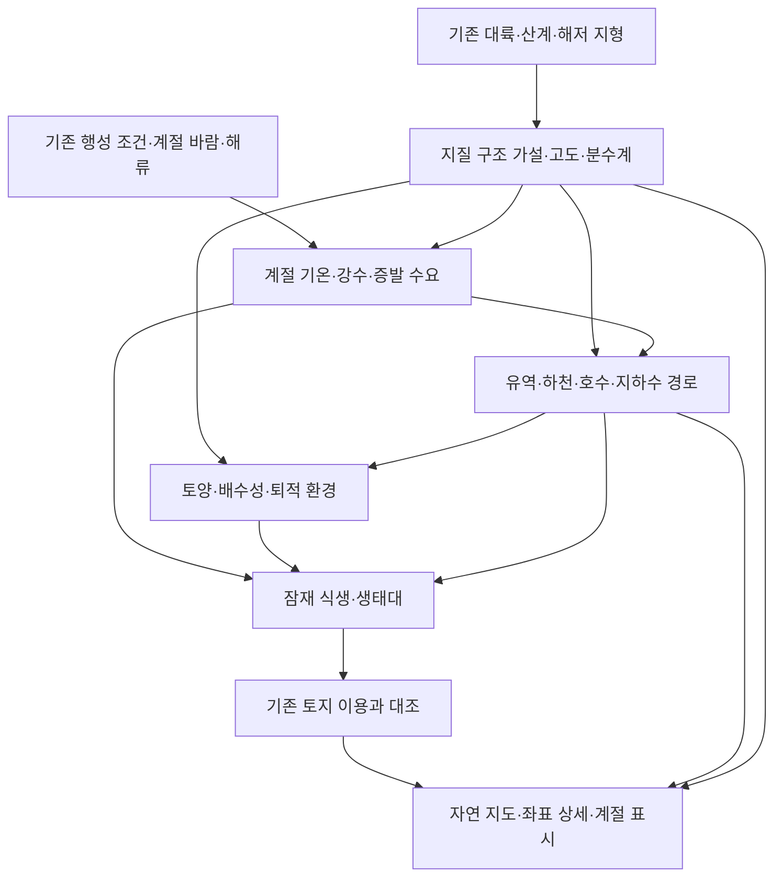

# 전 대륙 자연지리 설계안 v0.1

상태: 1~6단계 기본 구현 완료. [6단계 검토실](../natural-world/stage6/index.html), [결과 보고서](../natural-world/stage6/REPORT.md), [현재 지도](../natural-world/index.html)를 확인한다. 전역 검증과 층별 채택 후보·보류를 정리했으며 자동 채택은 하지 않았다. 실제 피복·습지 면적·토성·빙하·개별 화산과 완전한 유역별 원수지는 미정이다.6.5km는 고도 보간·속성 계승이며 미세 수계·피복 경계 분화는 후속 범위. 후속 우선순위는 큰 함몰부 출구·저류 대안, 서부 사막 핵심 경계·고온 PET 검토다. 아래는 원래 설계와 완료 기준이다.

후속 보정 검토3 완료: [웅덩이·원수지 보고서](../natural-world/pond-budget/REPORT.md).52개 국지 웅덩이별 유입·합류·재분리와 원본6850격자82200기간의 육지 물수지를 확보했다. 토양·얕은 지하수는 원본 통합 저장이며 개별 분리는 미정이다. 다음은 기존 기후와 맞는 수면 증발·눈/얼음 가정 및 육지→수면 동적 전환 물수지 비교다. 실제 수면·25m절하 채택·원격배포 없음.

이전 후속 보정 검토2 완료: [연쇄 검토 보고서](../natural-world/retention-chain/REPORT.md). 원본 출구3개안·독립 유역 유입·저지 연결 높이를 검산했다.25m 절하안은 내부 턱과 잠재 역수위 때문에 연쇄 결과 보류. 다음은 이 두 구역의 웅덩이별 유입·합류와 지역별 강수/ET/눈/토양 저장 추출이며, D144758는 수신 경계로 유지한다. 새 수면 채택·지형 수정·원격 배포 없음.

이전 후속 보정 검토1: 우선12함몰부 출구 진단 및 D126467의6개 저류 민감도 비교 완료. [결과](../natural-world/retention-review/REPORT.md). 원본 출구의 지연 넘침과 다음 D147845 미정 경계를 확인했으며 자동 채택하지 않았다. 다음은 D126467–D147845 연쇄 저지·출구·수면 원수지 검토다.

목표는 현재 세계의 대륙·기후·수계를 바탕으로, 모든 육지에서 산과 평야, 강과 호수, 숲과 초원, 습지와 화산이 서로 설명되는 자연지리를 만드는 것이다. 대상은 왕국·제국 9개 권역을 포함한 **현재 지도에 존재하는 모든 대륙과 섬**이다. 국가가 없는 지역도 같은 기준으로 다룬다. 행성 반대편의 새 대륙·문명은 이번 설계에 추가하지 않는다.

## 1. 현재 자료에서 확인한 출발점

| 항목 | 현재 확인한 내용 | 설계에 주는 의미 |
|---|---|---|
| 세계 기준 | application v0.107, worldDataVersion 77. 세계·지형 해시는 현행 Atlas와 일치 | 원본 세계를 기준으로 별도 자연지리 버전을 만든다 |
| 광역 지형 | 전 행성 1536×768, 0.234375도 격자. 남북 약 26.1km, 동서 간격은 위도에 따라 감소 | 전 대륙에 고도·육해 마스크가 있다. 작은 계곡·습지의 위치까지 확정된 것은 아니다 |
| 설계 지형 요소 | 현재 스냅샷에 능선 설계 요소 16개, 저지대 처방 5개, 설계 하천 7개 | 이미 있는 산계·본류를 자연지리의 기준선으로 사용한다. 요소 개수는 실제 산맥·평야 개수가 아니다 |
| 수계 | 원본 스냅샷에 배수 후보 선분 13,422개. 당시 유량 50m³/s 이상을 추출한 경로 후보 | 13,422개의 확정 하천이 아니다. 상시·계절 유량, 연결, 지형 충돌을 검사해야 한다 |
| Atlas 표현 | 현재 하천 표시 경로는 설계 하천 7개. 배수 후보망·전 대륙 식생 분류·화산 분류를 함께 표시하는 체계는 없음 | 자료 보완과 지도 표시 개선을 함께 진행한다 |
| 기후 | 광역 기온·바람·해류 근사는 4도, 12계절 표본. 수분 수송은 2도, 남북위 72도 사이 | 격자 지형을 세밀하게 만들어도 그만큼의 기후 정밀도가 생기지는 않는다 |
| 수원 최신화 | headwaters-0.40은 동쪽 북방산지를 주수원으로 채택. 수송 강수는 해당 수원과 호수에 적용하고 다른 지역은 기존 강수 처방 유지 | 오래된 v0.37 문제와 v0.38의 일률적인 연 800mm 처방을 현행 설정으로 되돌리지 않는다 |
| 정밀 지형 | terrain-v2의 25m급 요청 시 생성 지형은 기존 9개 권역 대상 | 전 세계 25m 지형·배수망 완성으로 표현하지 않는다 |
| 해저 | 동방 해구, 남방 해령, 서방 외해 해령이 기존 설계에 있음 | 화산대의 지질 가설을 세울 근거가 있다. 완성된 판구조 모형은 아니다 |

근거는 현재 자료 목록 (전체 인계 패키지: `evidence.json`), 세계 지도 원본 (전체 인계 패키지: `../../application/validation/world-map/world-map.json`), 기후 소스 (전체 인계 패키지: `../../application/source/app.js`), 세계관 (전체 인계 패키지: `../../worldbuilding/WORLD_HANDOFF.md`)이다. 과거 검토 보고서는 문제의 이력을 확인하는 자료이며, 최신 세계의 좌표·수량을 대신하지 않는다.

## 2. 세계의 개성을 유지하는 조건

1. **북쪽 육지 연결과 거대한 대초원**을 유지한다. 초원 안에는 하천림·숲초원·계절 습지가 들어갈 수 있다. 넓은 초원을 유지할 수 없는 기후 결과가 나오면 충돌로 기록하고 원인을 검토한다.
2. **서부 사막은 차갑고 건조한 고원·내륙형**을 기본으로 한다. 주변 산지의 비그늘과 수분 공급 경로를 함께 확인한다. 서부 사막 구간에서 북방산맥이 끊기는 통로를 막지 않는다.
3. **동대륙의 넓은 건조 내륙**, 동쪽의 상대적으로 습한 수원 산지, 그 물을 받는 분지·호수·서향 본류를 구분한다. 제국 호수가 있다고 동대륙 전체를 습윤림으로 바꾸지 않는다.
4. 서대륙 주요 왕국권은 온대의 계절 차이와 해양 완충을 함께 가진다. 북부 설원은 영구설·계절설·툰드라·침엽수림을 나누고, 서대륙 대부분을 빙상으로 처리하지 않는다.
5. 동대륙–남동대륙의 좁고 긴 육지 연결, 독립된 남서대륙, 기존 섬과 해안선, 주요 고개·분지 출구를 유지한다. 옛 문서의 분지 축소 비율보다 현행 형상을 우선한다.
6. 하루 24시간, 기본 자전축 23.4도, 반지름 6371km·365일인 현재 구현 기준을 사용한다. 두 위성은 해안 습지·조간대의 변동 요인이지만, 모든 해안의 조차를 일정한 배수로 확대하지 않는다.
7. 기존 국경·수도·인구·농지·식량·관개 장부는 기준안으로 보존한다. 새로운 숲이나 평야를 그렸다는 이유로 벌목량·농지·곡물 생산량을 자동 증가시키지 않는다.

### 자료의 지위

각 값은 ‘기존 설정’, ‘기존 모형값’, ‘새 설계 가정’, ‘미정’ 중 하나로 구분한다. 모형 계산이 성공했다는 사실은 물리적 타당성의 증명이 아니다. 원본 형상은 보존하되, 충돌이 확인되면 수정 후보와 영향 범위를 별도 버전으로 남긴다. 마법으로 기후·물수지의 공백을 메우는 전제는 추가하지 않는다.

## 3. 자연지리를 연결하는 구조

첫 버전은 이 순서로 일관성을 확보한다. 이후 식생이 증산·침투에 주는 영향을 연결할 때는 이전 결과와 비교하며 반복 계산한다. 완전한 대기순환·침식·생태계 장기 진화를 첫 버전의 완료 조건으로 삼지 않는다.

평야는 지형, 숲은 식생, 습지는 물이 머무는 상태, 화산은 지질 기원이다. 같은 좌표가 **‘충적평야 + 범람 습지 + 하천림’** 또는 **‘화산성 고지 + 온대림’**일 수 있도록 독립된 층으로 저장한다.

## 4. 대륙별 배치 제안

아래의 자연지리 조합은 현재 배치를 설명하기 위한 제안이다. 구체적인 경계·면적·새 지명은 아직 확정하지 않는다. 기후와 지형 검사를 통과한 구역부터 채택 후보로 만든다.

| 자연 권역 | 배치할 조합 | 현실성을 확인할 조건 |
|---|---|---|
| 북부 설원·극지 해안 | 고산 영구설, 저지 툰드라, 남쪽 침엽수림 전이, 해빙기 습지, 조건이 맞는 빙하호 | 추위만으로 빙상을 만들지 않고 적설과 융해를 함께 확인. 72도 밖 수분 모형 공백은 별도 표시 |
| 북방 대초원 | 넓은 초원·건조초원, 상대적으로 습한 가장자리의 숲초원, 강변 숲과 호소 | 해양에서 먼 거리, 강수의 계절성, 겨울 추위. 숲 확대를 억제할 화재·초식 영향은 별도 가정으로 기록 |
| 서대륙 북방산지와 왕국권 | 산지 침엽·혼합림, 구릉의 낙엽림, 큰 강 중하류의 평야·범람원·하천림 | 북부–남부 온도 차이와 사면별 수분 차이. 평야 전체를 초지 또는 농지로 간주하지 않음 |
| 서대륙 남쪽 해안·반도 | 건조 계절에 적응한 숲·관목지, 습한 사면의 숲, 짧은 해안 하천, 하구 습지 | 기존 온대·지중해성 방향과 12기간 강수. 반도 능선 양쪽을 같은 식생으로 도색하지 않음 |
| 서부 사막·건조 고원 | 자갈·암석 사막, 조건부 사구, 건조초원 전이, 와디, 염성 저지 | 비그늘·증발 수요·폐쇄 유역. 오아시스는 지하수 함양과 용출 경로가 설명되는 곳만 배치 |
| 동대륙 중앙 건조지 | 암석·자갈 사막과 건조 고원, 선상지, 계절 하천, 폐쇄 분지·염호 후보 | 작은 지류는 침투·증발로 끝날 수 있음. 사막에 균등한 푸른 하천망을 만들지 않음 |
| 동쪽 북방 수원 산지·동해안 | 습한 사면의 산림, 높은 곳의 고산초지·설원, 지류가 많은 수원 골짜기 | 현행 동부 주수원 구조 유지. 강수량·적설의 민감도와 수원 상류–호수 연결 확인 |
| 제국 분지·대호수·서향 본류 | 산록 선상지, 충적평야, 건조한 분지 바닥, 하천림, 얕은 호안의 갈대습지, 하구 습지 | 호수의 수량과 수질을 분리. 전 호안을 습지로 칠하지 않고 경사·수심·수위 변동 적용. 남쪽 육상 입구를 제2의 호수 출구로 바꾸지 않음 |
| 동대륙–남동대륙 연결부 | 따뜻하고 습한 사면의 열대림, 건기 있는 곳의 계절림·사바나, 구름이 잦은 산지의 운무림 후보 | 저위도라는 이유만으로 모두 정글로 지정하지 않음. 실제 수분 공급과 산지의 풍상·풍하 확인 |
| 남동대륙 | 기존 동쪽 주산맥과 남부 산계를 기준으로 산지림·고산대, 큰 강의 지류·저지, 북부 열대에서 남부 온대로의 전이 | 북쪽 무역풍과 남쪽 편서풍 구역을 구분. 대륙 전체에 한쪽 해안만 습하다는 규칙을 적용하지 않음 |
| 남서대륙 | 기존 서쪽·동쪽 산계와 큰 강을 따라 북부 열대·계절림, 중앙 유역의 평야·습지, 건조 분지와 남부 온대림 후보 | 북동쪽 만의 수분 공급, 두 산계의 비그늘, 남반구 계절 위상. 대륙 전체 정글화 방지 |
| 모든 섬·해안 | 크기·고도에 맞는 짧은 하천, 노출 해안 관목지, 석호·염습지, 따뜻한 보호 해안의 맹그로브형 숲 후보 | 작은 섬에 대륙 규모 수계를 만들지 않음. 파랑·조석·염분·퇴적 공간 확인. 해당 생물군의 존재는 새 설정 가정 |

### 화산 배치의 권고안

**동방 해구의 육지 쪽에, 동대륙 동해안에서 남동대륙 동쪽 산지로 이어지는 불연속 화산대 후보를 둔다.** 기존 해구와 산계의 위치가 가장 직접적인 근거다. 해구 위치는 현재 설정상 대략 동경 120~137도, 북위 40도~남위 55도 구간에 걸쳐 있다. 이 수치는 화산의 좌표가 아니다.

- 지질 가설은 해구의 해양판이 육지 쪽 아래로 들어가는 섭입 구조로 시작한다. 기존 해구·해안·산계 단면과 양립하는지 검토한 뒤 화산대를 그린다. 섭입 방향과 시기는 아직 확정되지 않았다.
- 북방의 긴 산계와 분지 둘레는 우선 융기·습곡·단층 산지 후보로 설명한다. 높다는 이유로 화산을 부여하지 않는다.
- 남방 해령·서방 외해 해령은 해저 화산 활동 후보다. 현재 해저가 깊으므로 자동으로 새 화산섬을 만들지 않는다.
- 남서대륙은 기존 산계의 기원을 먼저 정한다. 동방 해구와 같은 근거가 확인되기 전에는 활화산 밀도를 맞추려고 화산을 배치하지 않는다. 열점은 별도 근거가 필요하다.
- 개별 화산은 화산체·분화구·용암 지형과 활동 상태를 분리한다. 최근 분화 이력이 없으면 활동 상태는 ‘미정’이다. 휴화산·사화산·분화 확률을 임의 확정하지 않는다.

첫 지질 지도는 구조대 가설이다. 전 행성 판 경계와 지각 운동을 재현했다는 설명은 하지 않는다. 독립된 지역 가설끼리 충돌하면 통합 지질 설계에서 해결한다.

## 5. 자연물별 생성 규칙

### 산·구릉·평야

고도 하나가 아니라 주변 기복·경사·곡률·지형의 연속성으로 분류한다. 높은 고원도 평탄할 수 있고, 저지에도 급경사 협곡이 있을 수 있다. 기존 능선의 가지 산줄기 → 산록 구릉 → 선상지·계곡 → 평야가 이어지게 한다. 분수계와 본류를 먼저 고정하고 미세 기복을 붙인다. 독립적인 잡음이 배수로를 막거나 고개를 바꾸면 해당 상세 지형을 다시 생성한다.

### 강·하천·호수

하천을 유역 그래프로 만든다. 각 구간에 상류·하류, 합류점, 유역, 종착점, 계절 상태를 기록한다. 종착점은 바다·호수·폐쇄 저지·침투 소멸 구간 중 하나다. 본류와 지류, 간헐 하천, 사막의 와디를 구분한다. 분류 기준은 유역 면적뿐 아니라 강수·눈녹음·증발산·침투를 포함한다.

호수는 유입·유출·수면 강수·증발·저장 변화가 맞는 곳에 둔다. 자연 함몰이라고 모두 호수가 되는 것은 아니다. 배출구가 있는 담수호 후보, 증발이 우세한 염호 후보, 계절호, 빙하 지형의 호소를 나눈다. 염분 값은 염류 수지를 계산하지 않았다면 미정으로 둔다.

유역 물수지는 같은 계절·단위에서 ‘강수 + 외부 유입 = 증발산 + 외부 유출 + 저장 변화’로 추적한다. 지하수나 하도 손실이 모형 밖으로 나가면 별도 항으로 명시한다. 눈녹음은 저장된 물의 이동이며 새 강수가 아니다. 호수도 독립된 장부로 추적한다. 기존 하류 유량을 다시 상류 발생량에 더하지 않는다.

작은 격자 함몰과 설정상 폐쇄 분지를 구분한다. 수계 연결을 위해 수백 m의 가상 채움을 숨기지 않는다. 현재 고도·기존 하천·새 배수 경로가 충돌하면 위치·필요 보정량·영향을 기록하고, 지형 보정 또는 호수·습지·건조 저지 중 설명 가능한 후보를 비교한다. 원본 고도를 조용히 덮어쓰지 않는다.

### 습지·하구·해안

습지는 지하수위, 침수 지속 기간, 배수성, 강·호수와의 연결로 만든다. 비가 많은 산비탈과 물이 고이는 저지대를 구분한다. 하천 범람원, 호안 습지, 내륙 저습지, 이탄습지 후보, 염습지·조간대를 나눈다. 사막에도 외부 유입이 있으면 습지가 가능하다.

삼각주는 퇴적물 공급과 파랑·조석의 제거 능력을 함께 고려한다. 모든 하구에 삼각주를 찍지 않는다. 조석 지배 하구·삼각주·석호는 서로 다른 후보 형태다. 기존 두 위성 설정은 해안별 조석 계산의 입력으로 쓰고, 아직 해상도가 부족한 항만·좁은 수로는 미해상으로 표시한다.

### 숲·정글·초원

기온의 연평균뿐 아니라 최한기·최난기, 생장 가능 기간, 강수와 증발 수요, 건기의 길이, 토양 수분을 함께 사용한다. 열대 우림·열대 계절림·사바나, 온대림·건조림·관목지, 침엽수림·툰드라·고산대를 구분한다. ‘정글’ 표시는 열대림 계열의 사용자 친화적 묶음으로 제공하고 상세 유형을 함께 보여 준다.

‘자연 조건에서 가능한 식생’과 ‘현재 토지 피복’을 분리한다. 기존 농지·도시·방목지가 공간적으로 확인되면 대조한다. 국가 합계만 있는 농지를 임의의 평야에 배분하지 않는다. 토지 이용이 없는 외부 권역은 ‘잠재 식생 / 현재 이용 미정’으로 표시하며 무인 원시림으로 확정하지 않는다.

첫 분류의 임계값은 매개변수로 공개하고 경계 부근을 전이대로 둔다. 실제 분류 전 지구형 생물군·내한성·생장 반응을 사용하는 가정을 명시한다. 화재·초식·벌목 이력이 없으면 그 효과를 확정값으로 적용하지 않는다.

## 6. 좌표 데이터와 해상도

### 좌표를 찍었을 때 받을 정보

| 층 | 필수 정보 |
|---|---|
| 지형 | 원본/설계 고도, 경사, 기복, 주 지형·부 지형, 산계·평야 ID |
| 기후 | 12기간 기온·강수, 건기·한랭기, 모형 범위·공간 해상도 |
| 수문 | 유역 ID, 하류 종착점, 가까운 하천·호수, 상시/계절/간헐, 침수 기간 후보 |
| 식생 | 잠재 생태대, 현재 피복 또는 미정 사유, 수목·초본·나지·수면·빙설 비율 |
| 지질 | 구조대 가설, 화산 지형 유무, 활동 상태·근거 또는 미정 |
| 출처 | 기준 세계 해시, 생성 규칙 버전·시드, 근거, 설계 상태, 신뢰도와 한계 |

피복 비율은 상호 배타적인 항목으로 합계 100%를 맞춘다. 습지·화산·범람원 같은 중첩 속성은 이 합계에 다시 더하지 않는다. 미정은 null과 이유로 기록한다. 확률이나 신뢰도 점수는 교정 근거가 없으면 숫자로 만들지 않는다.

### 권고하는 세 단계

1. **전 대륙 기본층:** 기존 26.1km 남북 간격에서 모든 육지·호수 셀에 기본 자연지리 분류 또는 미정 사유를 부여한다. 해안선·본류·능선은 원본 벡터를 함께 사용한다.
2. **유역 상세층:** 기본층의 연결을 정한 뒤 4배 분할, 남북 약 6.5km의 설계 격자로 지류·평야·생태 전이를 상세화한다. 전 행성 기준 6144×3072, 약 1,887만 셀이므로 타일별 생성·저장과 메모리 예산을 먼저 검토한다. 이 간격은 생성 해상도이며 관측 정확도가 아니다.
3. **국지층:** 1km 이하 지형과 기존 25m급 표현은 선택 구역에서 필요에 따라 생성한다. 상위 유역의 출입구·유량·수면을 경계조건으로 받아야 한다. 전 세계 모든 25m 셀을 미리 저장하는 것은 이번 첫 구현의 완료 조건이 아니다.

기후는 원래의 거친 격자·계절값과 고도 보정을 보존한다. 1,887만 셀에 12기간 기후를 무조건 복제하지 않고, 필요한 타일에서 추정값을 만들되 원래 기후 해상도를 표시한다. 경도 연결·극지 면적·경도 방향 거리, 타일 경계의 유역 연결을 검사한다. 남북위 72도 밖은 수분 수송 결과를 가장자리 값으로 연장하지 않고 별도 극지 가정과 미확인 범위를 둔다.

같은 좌표·버전은 화면 배율과 관계없이 같은 자연물을 가리켜야 한다. 확대는 기존 요소를 상세하게 표현하는 과정이어야 하며 새로운 호수·화산이 무작위로 생기면 안 된다.

## 7. Atlas에서 보여 주는 방식

기본 지형 화면을 **자연 지도**로 확장한다. 지형 음영 위에 식생 색과 질감을 얹고, 강·호수·습지·설원·화산을 읽을 수 있게 한다. 숲의 나무 무늬와 화산 기호는 분류된 실제 설계 영역 안에서만 배치한다.

| 보기 | 주로 읽는 정보 | 표현 |
|---|---|---|
| 자연 | 지형과 식생, 주요 수계의 전체 모습 | 낮은 채도의 생태대 색, 얇은 음영, 물길 강조 |
| 지형 | 산지·구릉·평야·분지·협곡 | 고도색·기복·등고선, 선택한 산계·평야 강조 |
| 수계 | 유역·본류·지류·호수·습지·계절수 | 유역 경계, 하류 연결, 상시 실선·간헐 점선, 계절 수면 |
| 식생 | 숲·정글·초원·사막·툰드라·토지 이용 | 잠재 식생/현재 피복 전환, 전이대, 미정 영역 표시 |
| 지질 | 구조대 가설·화산대·화산체 | 지질선과 화산 기호, 활동 상태 구분 |

광역에서는 큰 산계·생태대·본류만, 권역 확대에서는 지류·호소·습지를, 상세 확대에서는 협곡·범람원·피복 경계를 보여 준다. 선 두께는 하천 규모를 읽기 위한 기호이며 실제 강폭과 구분한다. 색 외에 무늬·선 형태로도 분류를 읽을 수 있게 한다.

모든 대륙의 자연 지도에는 국가 소속에 따른 어두운 필터를 적용하지 않는다. 기존 경제 모드에서 자료가 없는 지역은 계속 미확인으로 표시한다. 국경은 별도 켜기/끄기이며 자연물 생성의 경계가 되지 않는다.

계절 슬라이더는 적설·낙엽·계절 수로·호안 침수 상태를 바꾼다. 한 달의 기온 변경으로 숲이 사막으로 전환되지는 않는다. 장기 기후 시나리오를 적용하는 경우에만 잠재 식생 재평가를 분리한다. 현재 식량 설정 실험이 전 행성 식생·화산을 재계산한 것처럼 보이지 않게 한다.

## 8. 구현 순서와 단계별 완료 조건

| 단계 | 작업 | 검토 가능한 결과 | 완료 조건 |
|---|---|---|---|
| 1. 전 대륙 기준층 | 최신 원본 고도·산계·본류·해저와 세계관 제약 통합, 자연 권역 정의 | 전 대륙 기준 지도, 보호할 요소 목록, 충돌 목록 | 모든 육지 포함. 기존 9권역 경계 밖 누락 없음. 세계 해시 일치 |
| 2. 기후·지질 근거 | 12기간 기후 추출, 수분 출처와 미해상 범위 표시, 해구·산계에 맞춘 구조대·화산대 후보 | 습윤/건조·한랭 전이 지도, 지질 후보 지도 | 사막·초원·동부 수원과 충돌을 설명. 화산 후보마다 지질 근거 존재 |
| 3. 연결 수계 | 기존 7개 본류 계열과 배수 후보를 검토, 유역·지류·호수·폐쇄 저지 구성 | 전 대륙 유역 그래프, 상시/계절 수계, 호소·습지 후보 | 모든 하천에 하류 종착점. 수원 중복 없음. 고도·연결 충돌을 해결하거나 미정 표시 |
| 4. 생태·지표 상세화 | 지형+기후+물+토양 가정으로 식생·습지·지표 재료 생성 | 전 육지 기본 분류, 상세 유역 타일, 좌표 정보 | 자연지리 상태/미정 사유 100% 제공. 국경·타일 경계 인공 단절 없음 |
| 5. 지도 표현 | 자연·수계·식생·지질 보기와 배율별 표시, 계절·좌표 패널 연결 | 모든 대륙을 탐색할 수 있는 Atlas 시안 | 대표 환경의 좌표 조회, 확대·축소 일관성, 모바일 범례·조작 확인 |
| 6. 검증·채택 후보 | 전 세계 검사, 기존 화면·계산 회귀 확인, 변경 전후 비교 | 기준안/자연지리안 비교, 가정 목록, 구현 보고서 | 물수지·연결·면적·버전 검사 통과. 경제 원본 보존. 남은 미정 명시 |

1차 구현은 전 대륙 기본층과 주요 자연물의 연결을 끝낸다. 이어서 6.5km 설계층을 확장하며, 25m 전역 생성이나 새로운 정밀 토목 검토 때문에 기본 완성을 무기한 미루지 않는다. 이번 문서는 이 실행 순서를 정한 설계안이며, 구현·배포 완료 기록이 아니다.

### 필수 검증

- **보존:** 원본 1,663개 파일과 기존 계산 입력·결과를 해시로 대조. 새로운 자연지리 버전과 기존 기준안을 동시에 재현할 수 있어야 한다.
- **물:** 유역별 유입·유출·저장 변화를 검산하고 절대/상대 잔차를 함께 기록. 초기 제안 허용 기준은 연간 처리 물량의 10⁻⁶ 또는 1m³ 중 큰 값이며, 수치 계산 기준으로서 물리 검증과 구분한다.
- **연결:** 분수계 횡단·상승 배수·끊긴 합류·순환 경로를 검사. 호수 저장과 연결 노드를 처리한 하류 그래프는 순환이 없어야 한다. 하구의 분류는 별도 구조로 처리한다.
- **자연 조건:** 열대림의 동결·건기 충돌, 건조지 상시 하천의 외부 수원, 습지의 물 공급, 영구설의 질량 수지, 화산의 지질 근거를 확인한다. 적설이 계속 쌓이는 모형을 안정된 빙하로 단정하지 않는다.
- **분해능:** 같은 좌표·유역의 다른 타일과 배율 결과가 연결되고, 미세화 전후 유역별 물·면적이 중복되지 않는지 확인한다. 단순한 보간을 새 기후 계산으로 표시하지 않는다.
- **현실성 대조:** 서대륙 온대 유역, 서부 건조 고원, 북방 초원, 제국 호수 수원, 남서 열대–온대 전이, 남동 산맥, 작은 섬, 극지에서 대표 단면을 비교한다.

## 9. 우선 채택할 설계 방향

현재 권고는 **기존 세계 형상을 유지하고 전 대륙의 자연지리층을 덧붙이는 안**이다. 새 산맥이나 큰 호수를 먼저 늘리기보다 기존 산계의 가지 능선·지류·산록·평야·식생 전이를 연결한다. 동방 해구 주변은 화산대의 첫 검토 대상, 남쪽 대륙의 저위도 습윤 구역은 열대림의 첫 검토 대상, 기존 큰 강과 호안은 범람원·습지의 첫 검토 대상이다.

현실성과 기존 형상이 충돌할 경우에는 위치와 이유를 제시하고 국지적인 수정 후보를 만든다. 새 이름·화산 개수·숲 비율·호수 개수를 미리 할당하지 않는다. 물·기후·지형 조건에 따라 자연물 밀도가 다르게 나타나도록 하는 것이 이 세계의 현실감을 높이는 기준이다.

## 검토4 완료 — 수면 전환과 기후 물수지

52개 웅덩이에서 원본 기후와 저장을 이어서 육지/수면을 전환하는6개 가정을 비교했다. 수면 증발은 기온 지수 민감도이며 실제 에너지·얼음 질량·지하수는 여전히 미정이다. 원본 이산식 재현과 새 연속 확장 계산을 구분하고39개 수치·자료 검사/9개 브라우저 검사를 통과했다. 상세 결과는 ../natural-world/surface-water/REPORT.md. 다음: 장기 눈 축적의 지속 가능성과 수면 에너지·실제 얼음·지하수 교환 가정을 좁힌 뒤 수면 채택 가능성을 검토. 다음 D144758 내부 처리와25m 절하는 계속 별도 보류.

## 검토5 완료 — 한랭 환경과 지하 교환

장기 적설55격자/극지 공백18격자를 찾고 원본 일사·융설/증발 잠열·조건부 열전도 결빙을 진단했다.4개 지하 교환안에서 물을 저장/환류 장부에 추적하고 필요 대수층 용량을 제시했다. 실제 빙하/얼음/지하수의 물리값은 미정이다.7검산/39수치·자료/9브라우저 통과. 상세는 ../natural-world/cold-water/REPORT.md. 다음: 검토1~5의 근거·가정·보류 항목을 전 대륙 지도에서 구분되는 검토 표식과 채택 목록으로 연결. 두 유역의 조건부 결과를 전 대륙의 사실로 일반화하지 않으며 실제 빙하·호소·대수층 경계는 미정 유지.

## 검토6 완료 — 전 대륙 지도에서 근거·가정·보류 연결

[검토 지도](../natural-world/review-atlas/index.html)와18개 채택 조건 목록 구현. 전 대륙268,857격자의 식생/배수 상태를 독립적으로 표시하고 국지6,850격자와55개 적설 후보의 적용 범위를 구분했다. 실제 피복·신규 호수·빙하·대수층·개별 화산 경계는 미정.11자료/조회·9브라우저 검사 통과. 다음: 서부 사막 설정과 식생 후보가 충돌하는 2,629격자의 원인·대안 비교. 기존 사막 경계·강수 처방·산계 비그늘을 대조하고 원본 유지안과 설정 변경 후보를 나란히 검토한다. 전 대륙 실제 피복·경제 장부 자동 변경 없이 진행.

## 검토7 완료 — 서부 사막의 설정·기후 충돌

[비교 지도](../natural-world/desert-review/index.html)와[판단 보고서](../natural-world/desert-review/REPORT.md). 서부 검토권7,409격자(전체 설계 타원과 다름)는 현재 사막0/숲2,629. 원본 수분 지수57칸 재현. B반건조 핵심·전이권 해석이 가장 작은 변경이지만 순수 사막 핵심을 충족하지 않음. C강수25/50% 삭감은 민감도로만 보관, 실제기후/유출/경제 미채택. 열린 통로·원본지형 유지.6검산·13자료/조회·8브라우저 통과. 다음: 전 대륙의 38°C 초과 PET 방법 공백 24,448격자 검토. 사용 가능한 원본 기후·일사·바람과 대안 PET의 입력 요건을 대조하고 적용 가능한 비교와 여전히 미정인 범위를 구분한다. 없는 일별 기온차·습도·순복사를 만들어 정밀 결과로 취급하지 않는다.

## 검토8 완료 — 고온 PET와 식생 민감도

[고온 비교 지도](../natural-world/pet-review/index.html)와[판단 보고서](../natural-world/pet-review/REPORT.md).24,448고온 공백의 원본 유지,24,239육지 Oudin 조건부 식생과209기존호수 구분. 식생 기준을 그대로 바꾸면 유효 대조에서도48,610분류변경. 고온 방법 보류 해제0,없던 일별 기온차·습도·순복사 미생성. 원본기후/지형/경제·열린 통로 보존. 다음: 전 대륙 자연지도 표시 통합. 지형·숲/초원/정글 후보·물길/호수·습지 후보·화산대 가설과 검토 상태를 한 화면의 간편한 레이어로 연결한다. 원본 세계의 자연물, 선별 후보, 미정/보류를 구분하고 서부 사막·고온 PET·국지 수면 검토 결과를 같은 좌표에서 열 수 있게 한다. 조건부 결과를 실제 피복·유량으로 자동 채택하지 않는다.

## 후속9 완료 — 통합 자연지도

[통합 지도](../natural-world/unified-atlas/index.html)와[보고서](../natural-world/unified-atlas/REPORT.md). 지형·식생·수계·지질·검토를6보기로 통합. 계산 후보와 기존 설정 구분,고온/서부충돌/국지범위 보류 유지. 실제피복·신규자연물 채택 없음.8빌드·12자료·12브라우저 통과. 다음: 기존 Atlas 진입점에 통합 자연지도를 연결하고 GitHub Pages 갱신을 진행한다. 세션에 있는 사용자의 배포·갱신 요청을 기준으로 기존 저장소·브랜치·Pages 경로를 먼저 확인한다. 정적 의존 파일·상대 링크·같은 좌표 이동을 검증하고 배포 후 실제 주소를 확인한다. 물리 자료나 후보 채택은 변경하지 않는다.
